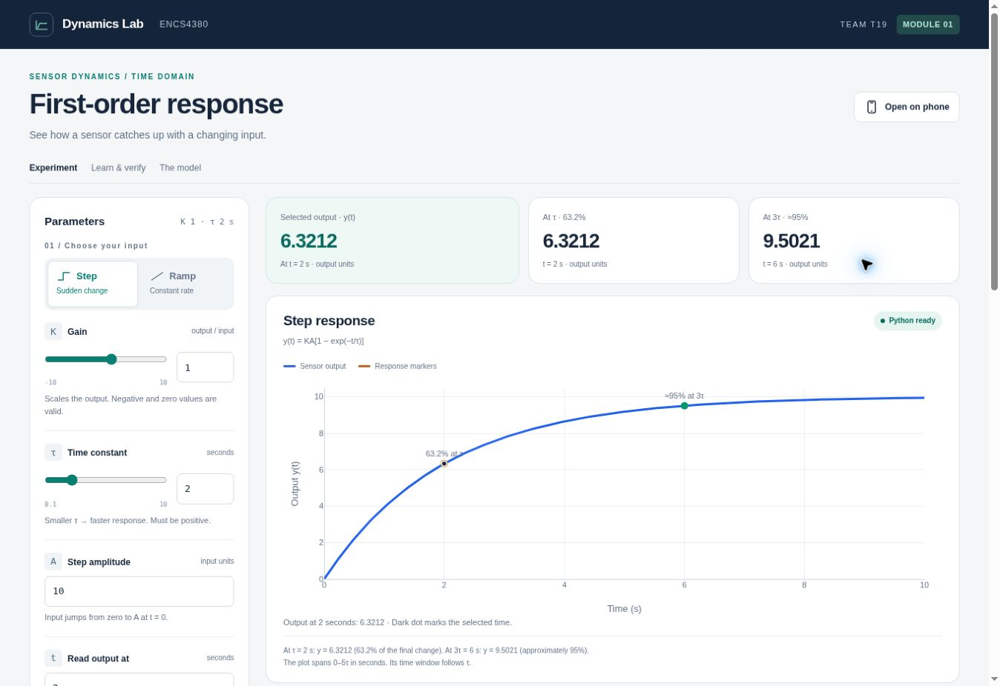
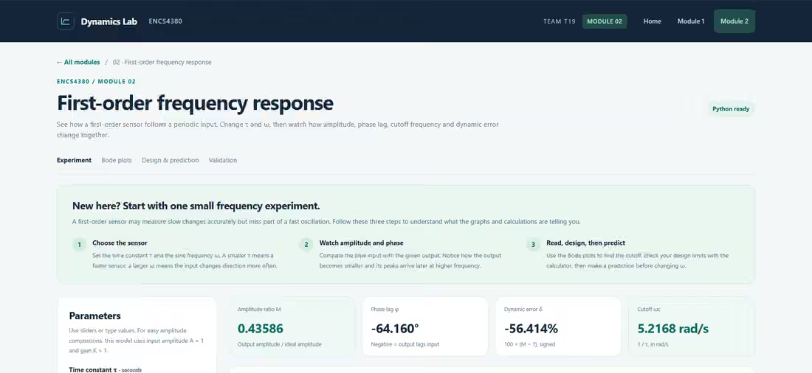
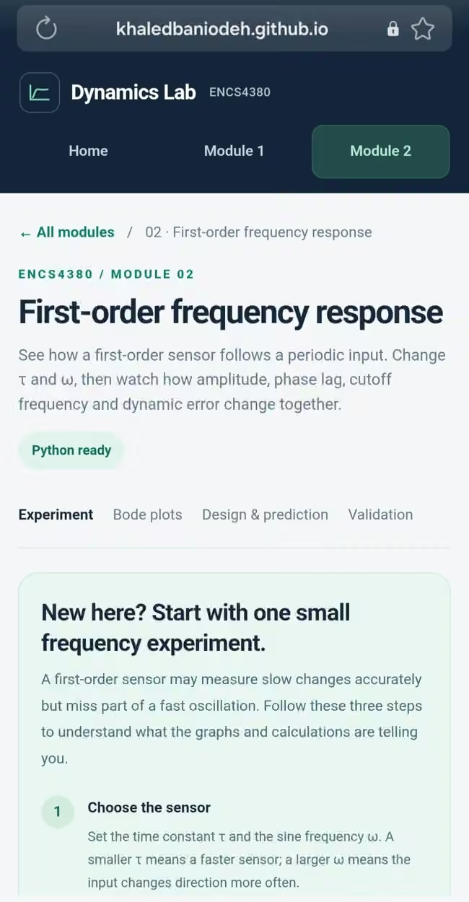
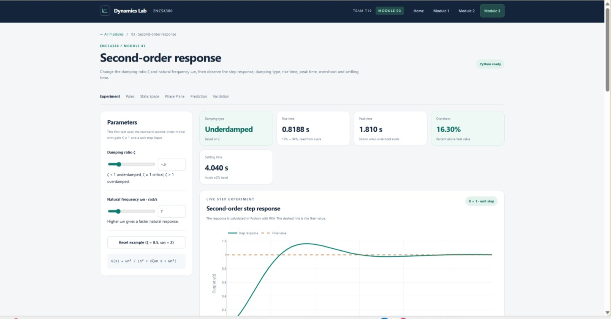
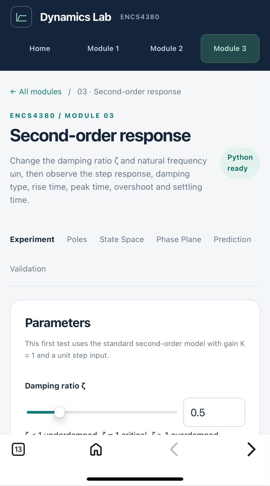
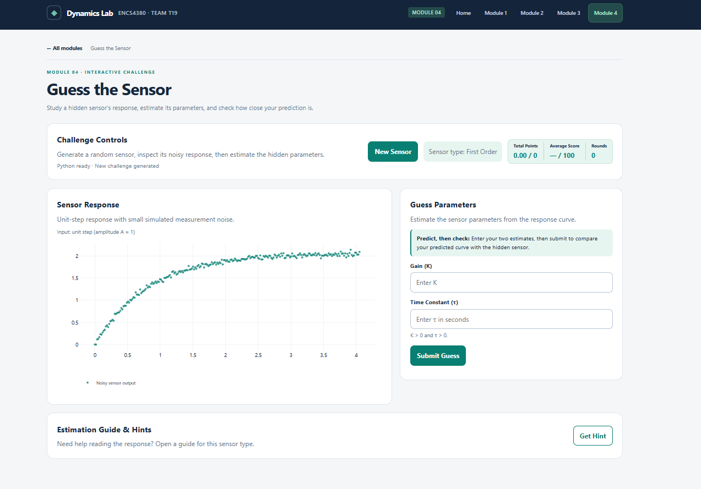
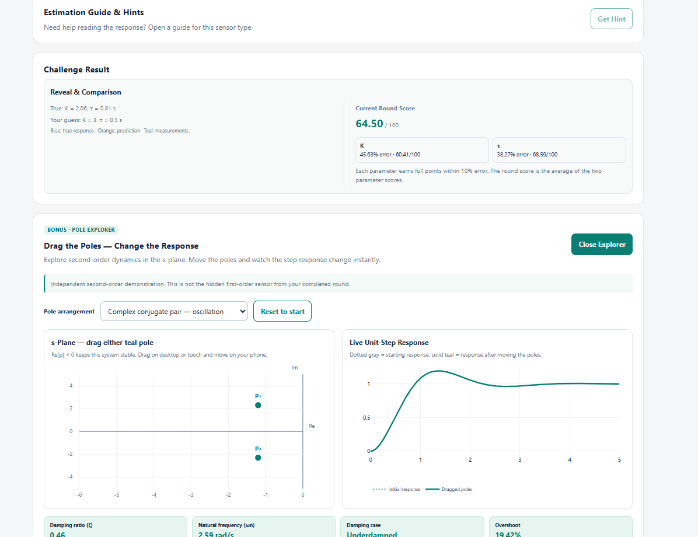

# ENCS4380 Dynamic Characteristics Interactive Toolkit — Team T19

ENCS4380 Interfacing Techniques, Birzeit University. Instructor: Dr. Wasel Ghanem.

**[Open the live toolkit](https://khaledbaniodeh.github.io/encs4380-dynamics-t19/)**

A static browser toolkit for understanding sensor dynamics through live controls, response plots, and parameter-estimation challenges.

## Modules and team

All four modules are implemented, linked from the home page and published on GitHub Pages. The home page includes an animated module overview and a beginner guide explaining inputs, outputs, reading error and ramp time lag. Its **Open on phone** header button displays the toolkit QR code and a copyable website link for all four modules.

| Module | Experiment | Owner | Tracking |
| --- | --- | --- | --- |
| [1](https://khaledbaniodeh.github.io/encs4380-dynamics-t19/module-1.html) | First-order time response: Step, Ramp and optional Euler comparison | Khaled Bani Oudeh ([@Khaledbaniodeh](https://github.com/Khaledbaniodeh)) | [#1](../../issues/1) |
| [2](https://khaledbaniodeh.github.io/encs4380-dynamics-t19/module-2.html) | First-order frequency response and v2 Superposition | Jibreel Haddar | [#2](../../issues/2) |
| [3](https://khaledbaniodeh.github.io/encs4380-dynamics-t19/module-3.html) | Second-order response, poles and state space | Waad Melhem ([@WaadMelhem05](https://github.com/WaadMelhem05)) | [#3](../../issues/3) |
| [4](https://khaledbaniodeh.github.io/encs4380-dynamics-t19/module-4.html) | Guess the sensor: hidden parameters, noise, hints and scoring | Mohammad Khaleel ([@mohak430](https://github.com/mohak430)) | [#4](../../issues/4) |

Open the live toolkit, choose a module and wait for **Python ready**. Calculations run in your browser; no hardware, installation or account is required. An internet connection is needed to load the Python and plotting libraries.

Implementation and browser checks are separate from instructor acceptance and final submission. The remaining delivery checks are listed below.

## Module 1: using the time-response experiment

1. Open the live link to see the toolkit introduction and learning path. Choose **Start with Module 1** or **Open module**. Module 1 has its own page at [module-1.html](https://khaledbaniodeh.github.io/encs4380-dynamics-t19/module-1.html). Wait for Python to load inside the module. Internet access is required for its CDN libraries.
2. Choose **Step** or **Ramp** using the input buttons in the Parameters panel.
3. Move the **K** and **τ** sliders, or type values in their number fields. Typed valid values can extend the initial slider ranges.
4. Set the Step amplitude A or Ramp slope r, then choose a time t to read the output at that instant.
5. Read the response plot and the mode-specific results. The plot covers 0 to 5τ; the selected-time output can also be evaluated outside that window.
6. Use **Reset example** to restore the default values. On narrow screens, **Edit parameters** and **View response** provide quick navigation; the Parameters panel can be collapsed.
7. In **Euler comparison**, change Δt to compare the numerical orange curve with the exact blue curve. Use its checkbox to hide the approximation; **How does this work?** explains the update and stability.
8. For **Predict, then check**, choose a nonzero Step, save a prediction, increase τ without changing K or A, then press **Check**. **New prediction** starts another attempt.

K, A and r may be positive, negative or zero. τ must be finite and strictly positive; t must be finite and nonnegative. Nonfinite inputs and results outside the supported numeric range produce an error message. For KA = 0, the normalized Step percentages, log-error plot and prediction exercise are not applicable.

### Module 1: try it on your phone

Open the live link in Chrome or Safari, or press **Open on phone** in the page header and scan its QR code with your phone camera. The dialog also includes the website link and a copy button; if clipboard access is unavailable, copy the visible link manually.

Wait for **Python ready**, then test both input modes, the sliders and number fields, the prediction exercise and horizontal scrolling in the validation table. Browser viewport checks do not replace testing on a real phone.

## Module 1 model and outputs

The model is a linear first-order sensor:

```text
τ dy/dt + y = Kx,     y(0) = 0
```

| Input | Closed-form output |
| --- | --- |
| Step from zero to A | y(t) = KA(1 − exp(−t/τ)) |
| Ramp x(t) = rt | y(t) = Kr[t − τ(1 − exp(−t/τ))] |

This is the zero-initial-condition model. It applies to sensors that can reasonably be represented as first-order linear systems; it is not a model of every sensor.

The page shows:

- Step markers at τ (63.2% of the final change) and 3τ (approximately 95%).
- Step error fraction E(t) = (KA − y(t))/KA = exp(−t/τ), on a logarithmic vertical axis.
- The explanation ln(E) = −t/τ and its slope −1/τ. The remaining-error section offers a base-10 logarithmic axis for E(t), plus a **Natural log · understand the slope** view (selected by default) that plots Python-computed ln(E) on linear axes, so the visible slope is exactly −1/τ. Beginner explanations distinguish sensor response error from numerical calculation error.
- Ramp input x(t), sensor output y(t), and ideal instantaneous output Kx(t). When K = 1, input and ideal output share one trace.
- Ramp current signed tracking error Kx(t) − y(t), steady-state signed error Krτ, and asymptotic time lag τ relative to Kx(t). This lag describes long-time tracking, not a pure delay. If the ideal output is constant (K = 0 or r = 0), that lag is not applicable.

τ and t use seconds. A uses input units, r uses input units per second, and K maps input units to output units.

### Validation check 1

Expected values are rounded lecture benchmarks. The page compares normalized fractions with tolerance 0.0005, equivalent to 0.05 percentage points, and displays expected output, computed output, percentages and Pass/Fail.

With K = 1, A = 10 and τ = 2 s:

| Time | Expected y | Computed y | Computed percentage | Result |
| --- | --- | --- | --- | --- |
| τ = 2 s | 6.3200 | 6.3212 | 63.2121% | Pass |
| 3τ = 6 s | 9.5000 | 9.5021 | 95.0213% | Pass |

For the default Ramp (K = 1, r = 2, τ = 2 s), y(2) = 1.4715, current tracking error = 2.5285, steady-state error = 4, and asymptotic lag = 2 s.

Checks performed during development include signed and zero K/A/r values, invalid time constants, slider/number synchronization, mode switching, and correct/incorrect predictions. These are development checks, not a claim of complete cross-device testing.

### Screenshot

Module 1 experiment dashboard with its parameter panel, live summary and response plot:



## Module 2: first-order frequency response

**[Open Module 2](https://khaledbaniodeh.github.io/encs4380-dynamics-t19/module-2.html)**

### How to use Module 2

1. From the home page, choose **Open Module 2**, or use **Home / Module 1 / Module 2 / Module 3 / Module 4** in the header navigation of the module page. **← All modules** also returns to the home page.
2. Wait for **Python ready**, then change the time constant **τ** (seconds) and angular frequency **ω** (rad/s) using the linked sliders or number fields. **Reset example** restores τ = 0.2 s and ω = 2 rad/s.
3. Compare the blue input sine with the green steady-state output. Read amplitude ratio **M**, phase lag **φ**, signed amplitude-based dynamic error **δ**, and cutoff angular frequency **ωc** in the metric cards.
4. Scroll to the two **Bode plots**. Their logarithmic frequency axes show magnitude in dB and phase in degrees. The orange cutoff marker is at ωc = 1/τ, and the point at your selected ω is highlighted.
5. Open **[Superposition](https://khaledbaniodeh.github.io/encs4380-dynamics-t19/module-2.html#superposition)** from the section navigation. Change ω₁, ω₂ and A₂ to build two sines; compare the blue combined input and green steady-state output, and read M₁ and M₂. The section shares τ with the main Parameters panel. **Reset example** restores ω₁ = 2, ω₂ = 12 and A₂ = 0.6, without changing τ.
6. In the **Dynamic-error calculator**, enter the *highest required frequency in Hz* and *maximum allowed amplitude error in percent*. Read the calculated maximum allowed τ, phase at half that frequency using τmax, and whether your currently selected sensor τ meets the limit.
7. For **Predict, then check**, first choose and save a prediction for M. Increase **ω** while keeping **τ** fixed, then press **Check**. Use **New prediction** to try again. The expandable explanation provides a worked example.
8. Review **Validation checks 2 and 3**: expected, computed, tolerance and Pass/Fail are shown for fixed lecture cases. They do not change with your sliders.

### Module 2 browser and phone checks

Jibreel Haddar reported that the original Module 2 controls, prediction exercise and dynamic-error calculator work on a physical phone, and supplied the screenshots below. This is a team report. Those screenshots predate **v2 Superposition**; the new controls, combined plot and reset still need a separate desktop and physical-phone interaction check.

### Module 2 screenshots

**Desktop view** — the navigation, introduction, parameters and live result cards:



**Phone view** — the responsive header, module links, introduction and single-column learning steps:



Screenshots provided by **Jibreel Haddar** on 5 November 2026 after testing Module 2 on his phone. They show the upper part of the interface; chart, calculator and validation interactions were tested by the team but are not pictured here. The screenshots are stored as PNG files, with the phone screenshot displayed at a compact width in this README. Click or open the image file to view it at its stored resolution.

Module 2 reuses the first-order sensor, now with a sinusoidal input. This implementation deliberately uses unit static gain and input amplitude, K = A = 1, to make the frequency-dependent ratio M clear. Its output sine is the **steady-state** part, not the initial switch-on transient.

- **Model:** G(s) = 1/(τs+1), M = 1/sqrt(1+(ωτ)^2), φ = −atan(ωτ). Angular frequency ω is always in rad/s, while the design calculator accepts f in Hz and converts with ω = 2πf.
- **Interactive inputs:** positive τ (seconds) and ω (rad/s), with linked slider and numeric controls. The sine plot shows input x(t) = sin(ωt) and output yss(t) = M sin(ωt+φ) across three cycles.
- **Metrics:** amplitude ratio, phase shift in degrees, signed amplitude-based dynamic error 100(M−1)%, and cutoff ωc = 1/τ. Equivalent sine-peak delay |φ|/ω is provided in seconds.
- **Bode:** logarithmic angular-frequency axes for 20log10(M) and φ (degrees), with highlighted current frequency and the cutoff at −3.01 dB / −45°.
- **Design calculator:** for a chosen maximum input frequency and permitted amplitude error, solve τmax = sqrt(1/(1−e)^2−1)/(2πfmax), where e is the allowed fractional error. Compare current τ with the limit. The displayed phase at half fmax is computed using τmax, not the current τ.
- **Predict, then check:** make a prediction about the amplitude ratio when ω rises and τ stays fixed; save it, change ω, and check the result.
- **Validation:** the page reports fixed course checks 2 and 3 with expected, computed, tolerance, and Pass/Fail. These tests do not depend on current sliders.
- **Architecture:** `module-2.html` loads `python/First-order frequency response.py` using Pyodide, then renders the returned Python-computed samples with Plotly. The URL uses percent-encoded spaces.
- **Limitations/testing:** the waveform is steady state, not the start-up transient; the first-order model assumes τ > 0, the input amplitude and gain are fixed at one, and ω > 0 is required for the logarithmic axis. The calculator's δ is an amplitude-ratio error, not instantaneous input-output difference or phase error. The original interface was tested on a phone by the team; independent cross-browser and v2 Superposition physical-phone testing remain pending.

### Module 2 v2 — Superposition of Sine Waves (extra-credit option)

**Version:** Module 2 v2, added **12 November 2026** by the Module 2 workstream (Jibreel Haddar). This update implements the homework's optional **Superposition** bonus choice: *build an input from two or three sine waves and observe how the sensor distorts the combination.* The on-site section is titled **“Superposition of Sine Waves”**, without the word “Bonus.”

This addition **does not replace** the required Module 2 plots, design calculator, prediction exercise, or lecture validation checks.

- **Input:** `x(t) = sin(ω₁t) + A₂ sin(ω₂t)`, with first-wave amplitude `A₁ = 1`. Sliders and number fields let the user change both angular frequencies from **0.5 to 24 rad/s**, and A₂ from **0 to 2**.
- **Sensor:** the original unit-gain first-order model `G(s) = 1/(τs + 1)`. Both components use **the current τ from the main Parameters panel**; the original single-wave ω control remains independent.
- **Linear superposition:** compute `Mᵢ = 1/sqrt(1+(ωᵢτ)²)` and `φᵢ = -atan(ωᵢτ)` for each frequency, then add the steady-state outputs:
  `yss(t) = M₁ sin(ω₁t + φ₁) + A₂ M₂ sin(ω₂t + φ₂)`.
- **Live visualization:** one Plotly chart overlays the **blue combined input** and **green combined output**. Two metric cards report M₁ and M₂; a note reports both phase shifts and the component output amplitudes. The input is sampled over **two periods of the slower wave**, with bounded adaptive samples to keep the faster wave visible and limit work on phones.
- **Reset / edge cases:** Reset restores ω₁ = 2, ω₂ = 12, A₂ = 0.6 (not τ). A₂ = 0 removes the second wave; equal frequencies remain mathematically valid, with a prompt to separate them for comparison. Invalid or out-of-range values show an error message.
- **Example:** τ = 0.2 s gives `M₁ ≈ 0.9285` for ω₁ = 2 rad/s and `M₂ ≈ 0.3846` for ω₂ = 12 rad/s. So the 12 rad/s component loses a larger fraction of its amplitude.
- **Assumptions:** no phase offsets at the input, `K = 1`, first amplitude fixed at 1, and **steady-state only**. This plot intentionally omits the start-up transient. M₁ and M₂ should not be interpreted as a single amplitude ratio for the combined waveform.
- **Testing:** `tests/test_superposition.py` adds seven Python regression tests (component ratios, waveform sum, zero/equal-frequency cases, attenuation, sampling bounds and invalid inputs), alongside the existing Euler tests. The [Python regression GitHub Actions workflow](.github/workflows/python-regression.yml) passed on 12 November 2026. HTML/JavaScript syntax and markup were inspected, and the GitHub Pages deployment succeeded; this does **not** establish full real-browser or physical-phone testing of the new controls.

**Bonus-grading note:** the assignment offers up to 10 additional points for *any one* optional bonus choice. Module 1 already contains the optional Forward Euler comparison. Adding Superposition in Module 2 does not guarantee more points beyond the rubric's bonus cap.

### Module 2 lecture benchmark calculations

| Check | Expected (rounded) | Calculated from formulas |
| --- | ---: | ---: |
| τ = 0.2 s, ω = 2 rad/s: M | 0.93 | 0.9284767 |
| τ = 0.2 s, ω = 2 rad/s: phase lag | 21.8° | 21.8014° |
| fmax = 100 Hz, allowed error = 5%: τmax | 0.52 ms | approximately 0.523 ms |
| Phase at 50 Hz using that τmax | 9.3° | approximately 9.33° |

The provided rounded benchmarks use tolerances of 0.01 for M, 0.2° for phase, and 0.02 ms for τmax. These values are independently calculated in the module; the page reports a Pass/Fail result for each.

## Module 3: second-order response

**[Open Module 3](https://khaledbaniodeh.github.io/encs4380-dynamics-t19/module-3.html)**

Module 3 uses the standard second-order model

```text
G(s) = ωn² / (s² + 2ζωn s + ωn²)
```

with live controls for damping ratio ζ and natural frequency ωn. The page classifies the response as underdamped, critically damped or overdamped and reports rise time, peak time, overshoot and 2% settling time from the simulated curve.

The same page also includes:

- A live s-plane pole plot.
- A mass–spring–damper state-space model with adjustable m, b and k.
- Live A and B matrices, derived ωn and ζ, eigenvalues of A and matching poles.
- A state-space s-plane plot that shows the eigenvalues and poles together so their matching locations are visible.
- A phase-plane plot of displacement x1 versus velocity x2.
- A Predict-then-check exercise for the effect of increasing ζ on overshoot.
- Validation checks for the three Module 3 lecture benchmarks.

The physical model uses

```text
A = [[0, 1], [-k/m, -b/m]]
B = [[0], [1/m]]
y = [1 0]x
```

The required step response uses the closed-form second-order solution, with RK4 shown as an optional numerical comparison. Rise time uses the 10–90% convention and settling time uses a ±2% band.

### Module 3 validation

| Check | Expected | Calculated | Result |
| --- | --- | --- | --- |
| ζ = 0.5 overshoot | 16.3% | 16.3029% | Pass |
| ζ = 1 overshoot | 0% | 0% | Pass |
| m = 1, b = 2, k = 4 | ωn = 2 rad/s, ζ = 0.5, poles/eigenvalues = −1 ± j1.732 | Matching values | Pass |

Module 3 was tested with underdamped, critically damped and overdamped examples on desktop, and its responsive layout and controls were also checked on a physical phone.

### Module 3 screenshots

**Desktop view** — the Module 3 header, section navigation, parameters, live metrics and second-order step response:



**Phone view** — the responsive Module 3 header, section links and parameter controls:



The screenshots were captured after testing Module 3 on desktop and a physical phone.

## Module 4: guess the sensor

**[Open Module 4](https://khaledbaniodeh.github.io/encs4380-dynamics-t19/module-4.html)**

This interactive challenge tests the concepts learned in Modules 1–3. The student works backwards from a simulated, noisy response to estimate a hidden sensor's parameters.

1. Wait for **Python ready**. A random hidden sensor is generated automatically; **New Sensor** starts another round.
2. Inspect the response. First-order sensors use a unit **Step** or a steady-state **Sine** at a stated angular frequency (rad/s); second-order sensors use an underdamped unit **Step**.
3. Estimate **K** and **τ** (first order) or **ζ** and **ωn** (second order). True values remain hidden until submission. **Get Hint / Hide Hint** explains the estimation method on request.
4. Press **Submit Guess** to reveal the true parameters and overlay the true curve (blue), guessed response (orange), and noisy samples (teal).
5. Compare your errors and score. **Total Points**, **Average Score**, and completed **Rounds** continue across new sensors until the page is reloaded. Each round counts only once.

### Screenshots

**Challenge interface —** the first-order noisy step response and parameter estimation fields before submitting a guess:



**Result and optional Pole Explorer —** revealed parameter values and round score, with draggable second-order poles and a live unit-step plot:



Both screenshots show the working Module 4 interface. The bonus is a separate teaching experiment, not the hidden sensor from a completed first-order challenge.

### Models and estimation

All challenge inputs have unit amplitude, and measurements include a small amount of simulated Gaussian noise.

- **First-order step:** `y(t) = K (1 − exp(−t/τ))`. At `t = τ` the response reaches approximately **63.2%** of the final value; at `3τ` it reaches approximately **95%**. A log-error plot has slope `−1/τ`.
- **First-order steady-state sine:** `x(t) = sin(ωt)`, `M = 1/sqrt(1+(ωτ)^2)`, phase lag `φ = −atan(ωτ)`, and output `y(t) = K M sin(ωt + φ)`. Estimate `τ = tan(|φ|)/ω` and `K` from the measured amplitude ratio. Four cycles are shown; the start-up transient is intentionally excluded.
- **Second-order step:** `G(s) = ωn²/(s²+2ζωn s+ωn²)`. For `0 < ζ < 1`, overshoot `Mp = exp(−πζ/sqrt(1−ζ²))` and peak time `Tp = π/(ωn sqrt(1−ζ²))`. Use the measured peak and settling level to estimate `ζ`, then `ωn` from `Tp`. Random second-order challenges remain underdamped so the peak is estimable.

**Scoring:** Each parameter earns **100/100** at relative error **≤10%**. For errors from 10% to 100%, partial credit decreases linearly to zero: `100 × (100 − error%)/90`. Errors **≥100%** receive zero. The round score is the mean of the two parameter scores; the session total is the sum of completed rounds. Parameters are strictly positive, avoiding division by zero. This partial-credit scale is the team's implementation choice; the 10% full-credit rule comes from the homework.

### Optional bonus — draggable Pole Explorer

After **Submit Guess**, open **Bonus · Pole Explorer** to drag poles in the s-plane with a mouse or touch, and watch the simulated second-order unit-step response change immediately. The **dotted gray** curve is the starting response; the **solid teal** curve follows the moved poles. The panel supports:

- **Complex conjugate poles** `p = −a ± jb`: `ωn = sqrt(a²+b²)`, `ζ = a/ωn`. For `b>0`, the response oscillates; when `b=0`, it is critically damped.
- **Two negative real poles** `p1 = −a, p2 = −b`: `ωn = sqrt(ab)`, `ζ = (a+b)/(2sqrt(ab))`. Different poles produce an overdamped response, and equal poles produce a critically damped response.
- **Reset to start** restores the initial poles. **Close Explorer** collapses the panel; **New Sensor** hides the bonus until the next valid submission.

The poles stay in the left half-plane (stable systems). For a completed first-order round, the bonus starts from an independent second-order example; for a second-order round, it starts from the revealed pole positions rounded to two decimal places. **Exploring poles never changes the guess, revealed answer, round score or session total.** The math and drag logic are in `js/pole_explorer.js`; scoring and challenge generation remain in `python/guess_sensor.py`.

### Running and testing

The deployed project runs directly on **GitHub Pages** with HTML/CSS/JavaScript, Plotly and Python via Pyodide; no account or backend is required. To run locally, serve the repository root with `python -m http.server 8000` and open `http://localhost:8000/module-4.html` (not `file://`). Internet access is needed to load the browser libraries.

- Module 4 Python regression: `python -m unittest discover -s tests -v`
- Bonus mathematics: `node tests/test_pole_explorer.js`
- Browser checks: first-order Step/Sine, second-order Step, hints, invalid inputs, reveal overlay, score isolation, duplicate-submit protection, reset and responsive widths. Physical-phone touch dragging should also be checked.

**Contribution:** Mohammad Khaleel ([@mohak430](https://github.com/mohak430)) implemented Module 4 and added the Pole Explorer bonus (see commit `7c5c297`). ChatGPT assisted with equations, coding, debugging, tests and documentation; the contributor remains responsible for understanding the code. A guided presentation is in [the demo walkthrough](docs/module4_demo.md).

## Files and technology

| File | Responsibility |
| --- | --- |
| `python/first_order.py` | Python exact responses, our scalar Forward Euler solver, error/lag metrics, validation and prediction evaluation |
| `python/First-order frequency response.py` | Module 2 v2: original sine/Bode calculations, design and checks 2–3, plus the `superposition_json` two-frequency waveform model |
| `module-2.html` | Module 2 v2: original frequency-response UI plus responsive Superposition controls, chart and section navigation |
| `tests/test_superposition.py` | Seven regression tests for Module 2 v2 superposition including zero amplitude, equal frequencies and invalid inputs |
| `.github/workflows/python-regression.yml` | Automated numerical regression tests on relevant pushes, pull requests and manual runs; not a Module 1 checkpoint guard |
| `python/second_order.py` | Closed-form second-order response, optional RK4 comparison, curve-based metrics, poles, state-space calculations, eigenvalues, phase-plane data and Module 3 validation |
| `module-3.html` | Interactive second-order response page with damping controls, poles, state space, phase plane, prediction and validation |
| `index.html` | Lightweight home page: introduction, learning path, module navigation and beginner help |
| `module-1.html` | First-order experiment, guided explanations, responsive controls, Pyodide bridge and Plotly rendering |
| `module-4.html` | Challenge controls, guessing, reveal overlays and session-score interface |
| `python/guess_sensor.py` | Random challenge generation, closed-form responses and scoring |
| `js/pole_explorer.js` | Independent optional second-order pole explorer: closed-form curves, pole dragging and sliders |
| `tests/test_pole_explorer.js` | Node assertions for complex, repeated and real-pole math |
| `tests/test_guess_sensor.py` | Seven numerical, random-challenge and scoring tests |
| `tests/test_integration.py` | Three local integration-helper tests using temporary fixtures |
| `README.md` | Live link, model assumptions, usage, validation and project status |

Python executes in the visitor's browser through **Pyodide v314.0.7** in all four modules. **Plotly.js 4.1.1** renders the curves. The CDN versions are pinned in the interactive module pages; the home page loads no Python or plotting runtime. Each module loads its own Python source through Pyodide and passes calculated values to Plotly. Internet access is needed to load CDN libraries.

The optional Pole Explorer uses its own browser JavaScript closed-form model; it does not change the Python challenge model or scoring.

GitHub Pages publishes the repository root from `main`. The deployed site needs no backend server, Binder or login. Numerical models remain in Python; Flask and Django are not used.

## Optional Forward Euler comparison

Required plots use the lecture's closed-form formulas. An optional **Forward Euler comparison** is implemented in Module 1. The default comparison is enabled with Δt = 0.5 s. It can be switched off without changing the exact response.

The solver uses our own Python loop:

```text
y[n+1] = y[n] + h * f(t[n], y[n])
f(t,y) = (K*x(t) - y)/τ
```

Step uses x(t) = A; Ramp uses x(t) = rt evaluated at the beginning of each step. Both start at y(0) = 0. The requested step is Δt, with a shorter last step if necessary to finish at 5τ. The solver does not evaluate the exponential formula to advance the numerical solution; the exact formula is evaluated separately for comparison.

Orange dashed lines and nodes overlay the exact blue response. Hovering an Euler node shows its approximate value, exact reference and absolute error. The comparison reports the maximum absolute error **at Euler nodes**, the final error at 5τ, and the number of steps. Errors use output units, so signed and zero inputs are supported without undefined percentage errors.

For the default Step (K = 1, A = 10, τ = 2 s), Δt = 0.5 s gives 20 steps, maximum node error approximately 0.51473 and final error approximately 0.035667. At Δt = 0.1 s, the maximum node error drops to approximately 0.093935.

The page explains the homogeneous Euler stability condition: every applied step must be less than 2τ. A coarse or unstable step gets an explicit message; stability does not guarantee accuracy. Invalid or overly small Δt values affect only the optional comparison. A 2,000-step limit keeps the browser responsive.

Development checks cover hand-calculated Step/Ramp updates, convergence when Δt is reduced, negative and zero signals, a final partial step, the stability boundary and unstable case, and invalid/excessive runs. RK4 is not used in Module 1; Module 1 uses the optional Forward Euler comparison.

Run the numerical regression checks from the repository root with standard Python:

```sh
python -m unittest discover -s tests -v
```

## Verification record — 12 November 2026

The Python suite contains **25 passing tests**: 8 Euler, 7 Superposition, 7 Module 4 model/scoring, and 3 integration-helper tests. Run it from the repository root:

```sh
python -m unittest discover -s tests -v
```

The [GitHub Actions workflow](.github/workflows/python-regression.yml) runs test discovery on relevant Python/test/workflow pushes and pull requests, and on manual dispatch. Integration-helper tests exercise temporary fixture pages; they do not prove that the live homepage or every browser interaction works.

| Area | Verification and remaining limits |
| --- | --- |
| Module 1 | Desktop interaction and 320/390 px browser-width checks; physical-phone check remains pending. |
| Module 2 | Formula review and Superposition unit tests pass. Original physical-phone testing was reported by Jibreel; the new v2 UI needs a separate interaction check. |
| Module 3 | Desktop and physical-phone testing were recorded by the team; lecture validations are documented above. |
| Module 4 | Independently exercised the published First-order Step, First-order Sine and Second-order Step flows, hints, invalid values, reveal curves, session totals and round locking. A 390 px browser-width submission also worked. Independent mathematical checks covered 1,000 seeded rounds, noise, exact-guess overlays, peak values and the 10% score boundary. Physical-phone testing remains pending. A teammate subsequently reported `Program terminated with exit(1)` during Python startup; the loader has been aligned with the other modules and now offers retry and diagnostic details. The affected device still needs to be retested before calling that report resolved. |
| Home page | Published guide and all four module links verified; 320/390 px browser-width checks showed no horizontal page overflow. Hero, module-flight JavaScript and module files were preserved during the guide update. |

Browser-width checks are not physical-device tests. Python tests do not replace browser or device checks. The successful Pages deployment was verified after the homepage guide update in commit [`1852f22`](https://github.com/Khaledbaniodeh/encs4380-dynamics-t19/commit/1852f22380b0cab7990aa0dc0325b07fd4972e31).

## Delivery checklist

- [x] Create the public repository using the required naming pattern.
- [x] Create one GitHub Issue per module.
- [x] Publish Module 1 on GitHub Pages and verify the live link in a desktop browser.
- [x] Implement K/τ sliders, Step/Ramp plots, markers, ramp metrics and log-error plot.
- [x] Add a Step prediction exercise and on-page validation check 1.
- [x] Document Module 1, its live link and an interface screenshot.
- [ ] Confirm all team members and the instructor have collaborator access.
- [x] Record an owner for each of the four modules.
- [ ] Verify on a physical phone: Step/Ramp switching, both sliders, number fields, prediction buttons, table scrolling and both plots.
- [x] Implement Module 2: sine input/output, magnitude/phase Bode plots, cutoff marker, dynamic-error calculator, prediction, and lecture checks 2–3.
- [x] Original Module 2 phone functionality confirmed by Jibreel Haddar; desktop/mobile screenshots supplied for README.
- [x] Implement Module 2 v2 Superposition of Sine Waves and add Python regression tests.
- [ ] Test the **new v2 Superposition controls, graph and reset** in desktop and physical-phone browsers; add a v2 screenshot after verification.
- [x] Implement Module 3: second-order response, poles, state space, phase plane, prediction, and validation checks 4–6.
- [x] Complete and browser-check Module 4: Step/Sine challenges, scoring, hints, reveal and session totals.
- [ ] Test Module 4 on a physical phone; a browser-width submission has been checked.
- [x] Add desktop and mobile screenshots for Module 3.
- [ ] Add a Module 4 screenshot and a v2 Superposition screenshot after the corresponding checks; complete any remaining contributor records.
- [ ] Create the final release tagged `v1.0` and submit the Pages link on the course page.

Instructor invitation: repository Settings → Collaborators → Add people → `ghanem@staff.birzeit.edu`.

## Schedule

| Date (2026) | Deliverable |
| --- | --- |
| 3 November | Checkpoint 1: GitHub Pages live and Module 1 working |
| 9 November | Checkpoint 2: Modules 2 and 3 working |
| 12 November | All four modules; release tagged `v1.0`; submit the Pages link |
| 15–16 November | Group demos: 10 minutes plus questions |

Each checkpoint is a five-minute check in the lab. The brief specifies a five-point deduction for each missed checkpoint.

## Validation checks 2–6

| Module | Expected result from the brief | Status |
| --- | --- | --- |
| 2 | τ = 0.2 s, input sin(2t): amplitude ratio approximately 0.93; phase lag 21.8° | Implemented in validation table |
| 2 | Up to 100 Hz, at most 5% dynamic error: τmax approximately 0.52 ms; phase lag approximately 9.3° at 50 Hz | Implemented in validation table |
| 3 | ζ = 0.5: overshoot approximately 16.3% | Implemented; calculated 16.3029%, Pass |
| 3 | ζ = 1: no overshoot | Implemented; calculated 0%, Pass |
| 3 | m = 1, b = 2, k = 4: eigenvalues/poles −1 ± j1.732; ζ = 0.5; ωn = 2 rad/s | Implemented; values match, Pass |

Module 3 checks are calculated by the page and shown with expected, calculated and Pass/Fail results. Each implemented module includes its own Predict, then check interaction.

## Course references

- ENCS4380 Homework 1: Dynamic Characteristics Interactive Toolkit, released 29 October 2026.
- Static and Dynamic Characteristics lecture slides.
- State-Space Modeling notes, 2026 edition: Example 3, Sections 6 and 7.1; Section 8 for the optional Micromouse simulation bonus. Obtain and confirm this exact reference before reusing its code.

## Checkpoint and versioning

| Milestone | Date | Current status |
| --- | --- | --- |
| Checkpoint 1 — Module 1 | 3 November 2026 | A reference snapshot was saved in the `checkpoint/module-1` branch at [`20847b4`](https://github.com/Khaledbaniodeh/encs4380-dynamics-t19/commit/20847b440a8155a036944168de1af0f5aacff641). This preserves the code; it does **not** by itself confirm instructor acceptance. |
| Module 2 — First-order frequency response (v1) | 5 November 2026 | Implemented on `main`, documented with PNG screenshots, and phone-tested by Jibreel Haddar. |
| **Module 2 v2 — Superposition** | **12 November 2026** | Added optional two-sine Superposition experiment with independent ω₁/ω₂/A₂ controls, shared τ, output plot, reset and regression tests. GitHub Actions numerical tests passed; v2 phone check pending. **This is a module version description, not a Git tag or separate release.** |
| Checkpoint 2 — Modules 2 **and** 3 | 9 November 2026 | **Ready for presentation.** Modules 2 and 3 are implemented; Module 3 has been tested on desktop and phone and all three required validation checks pass. |
| Final submission — All four modules | 12 November 2026 | **Pending.** Create the `v1.0` release only after Modules 1–4 and the final submission checks are ready. |

**Branches and releases:** `main` contains the current four-module site. [`checkpoint/module-1`](https://github.com/Khaledbaniodeh/encs4380-dynamics-t19/tree/checkpoint/module-1) preserves the original Module 1 source at `20847b4`. No GitHub Release was listed at this review on 12 November; the final published `v1.0` release and course-page submission remain pending. A snapshot branch is not a release.

**Protecting earlier work:** Module 1's Python model and Euler tests still match the saved snapshot. Compared with that snapshot, current `module-1.html` includes three explanation/default-view edits in the Step error section, plus module-navigation markup and styles added during Module 4 integration. Its current blob is `f50b2502b267ea84c2fb285a77b70589229a0714`; the saved HTML blob remains `20ce7df8bd2a7087499af983430b7aefcfe9bd33`. The original checkpoint branch is unchanged. The previously described **Module 1 checkpoint guard is not installed**; the Python regression workflow is not a snapshot guard, branch protection or a deployment gate. Review any future Module 1 edit separately and preserve the saved reference.

See [`docs/versioning.md`](docs/versioning.md) for the historical checkpoint record. Its current-main comparison predates Module 4 integration; the current differences are recorded above.

## ## AI Assistance

During this project, we used ChatGPT and Claude as supporting tools to help us understand and implement some parts of the project. ChatGPT helped us understand the mathematical equations behind the different sensor models and how to translate these equations into Python functions that could be used to calculate and plot the sensor responses. It also helped us understand how to connect the Python code with HTML and JavaScript using Pyodide, so the calculations could run directly in the browser and the plots could update when the user changes the input parameters.

For the website interface, our team decided on the overall design, layout, colors, and how we wanted to present the different modules. We then used Claude to help turn our design ideas into HTML and CSS code. ChatGPT also assisted us in organizing the interface, improving the arrangement of sections, and making the pages easier to navigate and use on different screen sizes.

We also used ChatGPT to better understand the purpose of the optional bonus features, such as Forward Euler, Superposition, and Pole Explorer, and how these features could be integrated into the existing modules without affecting their main functionality. In addition, AI assistance was useful for reviewing parts of the code, identifying possible issues, and suggesting ways to improve the explanations and documentation.

Throughout the project, our team made the main decisions about the features and design, reviewed the generated code, tested the implementation, and worked on understanding the mathematical concepts and programming logic so we could explain our work during the project demonstration.

